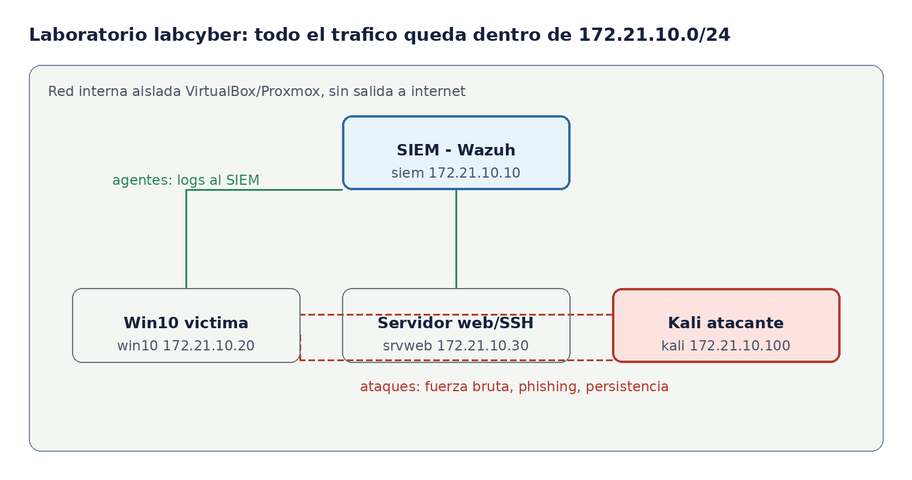

# Práctica guiada · Detección defensiva purple team con Wazuh

Oct 29, 2026 · @María RN

## Datos de la práctica

En esta práctica el alumnado detecta tres ataques reales lanzados dentro del laboratorio aislado, escribe la regla que los caza en el SIEM y documenta el incidente. Se trabaja en parejas con dos roles que se intercambian: equipo rojo (ataca) y equipo azul (detecta). El enfoque purple team hace que cada ataque termine en una detección y una regla nueva.

| Campo | Valor |
| --- | --- |
| Módulo | MP5021 Incidentes de Ciberseguridade |
| Resultados de aprendizaje | RA2 (detección y análisis), RA3 (respuesta), RA5 (notificación) |
| Criterios de evaluación | Detección sobre telemetría, correlación en SIEM, clasificación y notificación del incidente |
| Duración | 4 horas (2 sesiones de 2 h) |
| Agrupamiento | Parejas, roles rojo/azul intercambiables |
| Laboratorio | labcyber, red interna aislada 172.21.10.0/24 (VirtualBox o Proxmox) |
| Entrega | Informe por pareja + capturas + reglas creadas |

**Objetivos.** Al terminar, el alumnado será capaz de: comprobar que la telemetría llega al SIEM; reconocer en los registros la huella de un ataque de fuerza bruta, de ejecución de código desde Office y de persistencia; escribir una regla de detección en Wazuh y mapearla a MITRE ATT\&CK; y clasificar y notificar el incidente según la Guía Nacional de Gestión de Ciberincidentes.

## Escenario

**TecnoMariña S.L.** es una pyme gallega ficticia con un servidor web y SSH en su red interna y puestos Windows para el personal. Su SIEM (Wazuh) recoge los registros de todos los equipos. Un atacante ya ha conseguido entrar en la red interna y lanza varios ataques desde una máquina Kali. El equipo azul (SOC de la empresa) tiene que detectarlos a tiempo.

Todo ocurre en la red interna aislada **labcyber (172.21.10.0/24)**, sin salida a internet, de modo que los ataques son reales pero no salen del laboratorio.



*Laboratorio labcyber · 4 VM en la red aislada 172.21.10.0/24*

| VM | IP | Rol en la práctica |
| --- | --- | --- |
| siem | 172.21.10.10 | SIEM Wazuh: recibe logs, correla y alerta (equipo azul) |
| win10 | 172.21.10.20 | Puesto víctima: recibe el phishing y ejecuta la macro |
| srvweb | 172.21.10.30 | Servidor web/SSH víctima: sufre la fuerza bruta |
| kali | 172.21.10.100 | Máquina del atacante (equipo rojo) |

**Roles.** El *equipo rojo* ejecuta los ataques desde Kali siguiendo el guion. El *equipo azul* trabaja en el panel de Wazuh: observa, investiga y escribe las reglas. A mitad de práctica se intercambian para que todo el alumnado pase por los dos lados.

## Fase 0. Preparación y comprobación de la telemetría

Antes de atacar nada, el equipo azul comprueba que el SIEM está recibiendo datos. Sin telemetría no hay detección posible: es el punto de partida de todo el módulo.

1. Arrancar las cuatro VM del laboratorio y comprobar que se ven entre sí con `ping` dentro de 172.21.10.0/24.
2. En el SIEM, abrir el panel de Wazuh (reenvío de puertos NAT: `https://localhost:8443` desde el anfitrión).
3. Confirmar en *Agents* que win10 y srvweb aparecen como **Active**. Si alguno está desconectado, revisar el servicio del agente antes de seguir.
4. Generar un evento de prueba y verlo llegar:
   - En srvweb, hacer un intento de login fallido por SSH a propósito.
   - En el panel, buscar ese evento en *Security events* y anotar el campo que lo identifica (regla, nivel, IP de origen).

**Pregunta de control.** ¿Qué campos del evento permiten saber qué equipo lo generó y desde dónde? Anotadlos: los vais a usar en todas las reglas.

> Nota de seguridad: todos los ataques de esta práctica se lanzan únicamente contra las VM del laboratorio y dentro de su red aislada. No se atacan equipos reales ni del centro ni de internet.

## Fases 1 a 3. Tres ataques, tres detecciones

Cada ejercicio sigue el mismo ciclo purple team: el rojo ataca, el azul lo ve en el SIEM, escribe o ajusta la regla y lo mapea a MITRE ATT&CK. Dedicad unos 40 minutos a cada uno.

### Fase 1. Fuerza bruta SSH contra el servidor

**Ataque (rojo).** Desde Kali, lanzar un ataque de diccionario contra el SSH de srvweb:

```
hydra -l admin -P /usr/share/wordlists/rockyou.txt ssh://172.21.10.30 -t 4
```

**Detección (azul).** En el panel, buscar los eventos de autenticación de srvweb. Se verán muchos fallos seguidos (`sshd: authentication failure`) desde 172.21.10.100 y, si el diccionario acierta, un acceso correcto justo después.

- Wazuh ya trae reglas para esto: la **5710** (intento fallido) y la **5712** (fuerza bruta, varios fallos en poco tiempo). Comprobad que saltan.
- Localizad el campo `srcip` y el usuario objetivo.

**Regla.** Crear una regla local que suba el nivel y añada una etiqueta propia cuando haya fuerza bruta desde la red interna. En `/var/ossec/etc/rules/local_rules.xml`:

```xml
<group name="local,authentication_failures,">
  <rule id="100100" level="10">
    <if_matched_sid>5712</if_matched_sid>
    <description>Fuerza bruta SSH detectada desde la red interna</description>
    <mitre><id>T1110</id></mitre>
  </rule>
</group>
```

**ATT&CK.** T1110 Brute Force. Reiniciar el servicio de Wazuh, repetir el ataque y confirmar que ahora salta la regla 100100.

### Fase 2. Ejecución de PowerShell desde un documento de Office

**Ataque (rojo).** Simular el phishing: en win10, abrir un documento de Word con una macro que lanza PowerShell (el guion del rojo lo entrega por el laboratorio de correo aislado). La macro ejecuta algo como:

```
powershell -nop -w hidden -enc <comando codificado en base64>
```

**Detección (azul).** Con Sysmon instalado en win10, el evento **1** (creación de proceso) muestra que `WINWORD.EXE` es el padre de `powershell.exe`. Ese patrón (una ofimática lanzando una shell) casi nunca es legítimo.

- Buscad en el panel los eventos de Sysmon de win10 y localizad `ParentImage` y `CommandLine`.
- Fijaos en los indicadores: proceso padre Office, ventana oculta (`-w hidden`) y comando codificado (`-enc`).

**Regla.** Detectar que Word o Excel lanzan PowerShell:

```xml
<group name="local,sysmon,">
  <rule id="100110" level="12">
    <if_group>sysmon_event1</if_group>
    <field name="win.eventdata.parentImage">WINWORD.EXE|EXCEL.EXE</field>
    <field name="win.eventdata.image">powershell.exe</field>
    <description>Office lanza PowerShell: posible macro maliciosa</description>
    <mitre><id>T1566.001</id><id>T1059.001</id></mitre>
  </rule>
</group>
```

**ATT&CK.** T1566.001 Phishing con adjunto y T1059.001 PowerShell.

### Fase 3. Persistencia en el equipo comprometido

**Ataque (rojo).** Desde la sesión obtenida en win10, crear persistencia con una tarea programada o una clave de registro de arranque:

```
schtasks /create /tn ActualizadorSistema /tr "powershell -nop -w hidden -c IEX(...)" /sc onlogon
```

**Detección (azul).** El evento de Sysmon o de Windows muestra la creación de la tarea (`schtasks.exe`) o la modificación de la clave `Run`. Lo sospechoso es el nombre que imita a algo del sistema y que ejecuta PowerShell oculto.

- Buscad los eventos de creación de tareas programadas en win10.
- Relacionadlos con la sesión de la fase 2: es el mismo atacante asegurando el acceso.

**Regla.** Alertar de tareas programadas que ejecutan PowerShell:

```xml
<group name="local,sysmon,">
  <rule id="100120" level="12">
    <if_group>sysmon_event1</if_group>
    <field name="win.eventdata.image">schtasks.exe</field>
    <field name="win.eventdata.commandLine">powershell</field>
    <description>Tarea programada que ejecuta PowerShell: posible persistencia</description>
    <mitre><id>T1053.005</id></mitre>
  </rule>
</group>
```

**ATT&CK.** T1053.005 Scheduled Task. Con esto, el equipo azul ha cubierto tres fases de la cadena de ataque: acceso, ejecución y persistencia.

## Fase 4. Gestión del incidente, CVE/CVSS y notificación

Detectar es solo la mitad. Ahora el equipo azul trata los tres ataques como un único incidente y lo gestiona de principio a fin, que es el núcleo del módulo.

1. **Reconstruir la línea temporal.** Ordenar los eventos de las tres fases: fuerza bruta, ejecución de la macro y persistencia. Mostrar que es un solo atacante avanzando por la red.
2. **Clasificar.** Asignar tipo y peligrosidad según la taxonomía de la Guía Nacional de Notificación y Gestión de Ciberincidentes (intrusión, código dañino). Justificar el nivel por el impacto en confidencialidad, integridad y disponibilidad.
3. **Vincular una vulnerabilidad.** Si el acceso inicial se aprovechó de un servicio sin parchear, buscar su **CVE** y calcular o leer su **CVSS**. Ejercicio: para el servidor web del laboratorio, localizar un CVE de su versión y anotar el vector CVSS y la nota base.
4. **Contener y erradicar.** Proponer acciones: bloquear la IP del atacante, deshabilitar la cuenta usada, eliminar la tarea programada y restaurar el equipo.
5. **Notificar.** Indicar a qué CERT correspondería (INCIBE-CERT para una empresa privada) y en qué plazo, recordando que, mientras no se publique la ley española de NIS2, rigen RGPD (72 h a la AEPD si hay datos personales) y la directiva NIS2.
6. **Lecciones aprendidas.** ¿Qué reglas faltaban? ¿Qué se podría haber detectado antes? Aquí se cierra el ciclo: las reglas creadas en las fases 1 a 3 son la mejora concreta.

**Mini-ejercicio de CVSS.** Dado el vector `CVSS:3.1/AV:N/AC:L/PR:N/UI:N/S:U/C:H/I:H/A:H`, decir qué nota da (9,8, crítica) y explicar por qué: explotable por red, sin credenciales ni interacción, con impacto total. Luego cambiar `AV:N` por `AV:L` y comentar cómo baja la nota y por qué.

## Entregables y rúbrica

Cada pareja entrega un **informe de incidente** (3 a 5 páginas) con: la línea temporal de los tres ataques, una captura por cada detección, las tres reglas creadas con su mapeo ATT&CK, la clasificación y el CVE/CVSS asociado, y las acciones de contención y notificación propuestas.

| Criterio | Peso | Qué se valora |
| --- | --- | --- |
| Telemetría y detección | 25% | Los tres ataques se localizan en el SIEM con los campos correctos |
| Reglas y ATT&CK | 25% | Las reglas funcionan y están bien mapeadas a las técnicas |
| Gestión del incidente | 25% | Línea temporal, clasificación y contención coherentes |
| CVE/CVSS y notificación | 15% | Vulnerabilidad bien identificada y notificación correcta |
| Informe | 10% | Claro, ordenado y con evidencias |

## Notas para la docente

- **Encaje curricular.** La práctica es defensiva de principio a fin, en la línea de MP5021. Lo ofensivo (el equipo rojo) es solo el disparador para que haya algo que detectar; no es el objetivo evaluable.
- **Ajuste de recursos.** Con 32 GB por puesto, las cuatro VM arrancan holgadas. En equipos más justos, se puede prescindir de win10 y hacer las fases 2 y 3 con logs de ejemplo precargados.
- **Nivel ampliado.** Añadir una regla Sigma y convertirla al formato de Wazuh, o meter Suricata para detectar la fuerza bruta también por red (IDS), no solo por log.
- **Conexión con el otro material.** El ejercicio de phishing de la fase 2 enlaza con el entregable de phishing de UD1; aquí se trabaja el lado de la detección, no el del análisis del correo.
- **Seguridad y ética.** Recordar al inicio que las herramientas (Hydra, macros) solo se usan dentro del laboratorio aislado, y comentar el marco legal del hacking ético frente al no autorizado.
- **Soluciones.** Las reglas que aparecen aquí son la solución de referencia: en la versión de alumnado conviene dejar el objetivo y los campos a localizar, pero no el XML completo.
